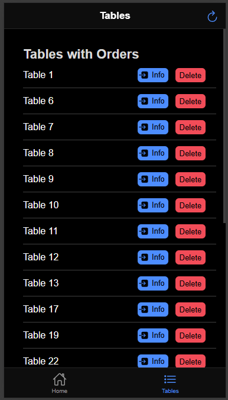
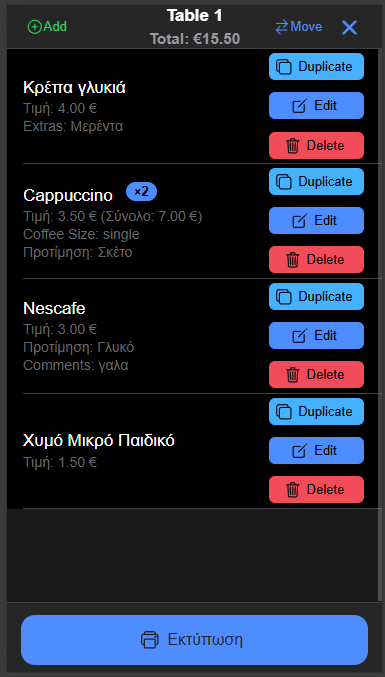
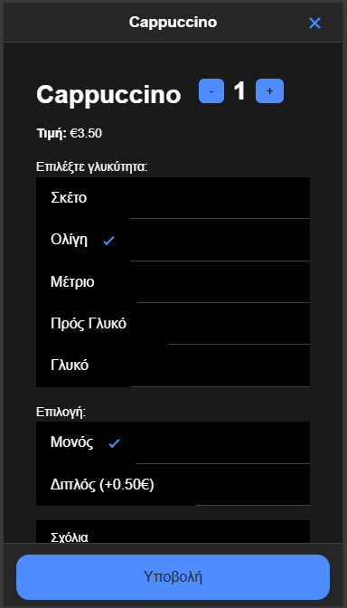

# PDA App Ordering System

## Screenshots

This is a full-stack ordering platform built with Angular, Ionic and Node.js.

## Features
- Customer ordering
- Automatic printing

## Tech Stack
- Angular
- Ionic
- Node.js

## Installing and testing

Use `npm ci` to install the versions in `package-lock.json`, and commit the
lockfile together with dependency changes. Run `npm test -- --watch=false` for
a single Vitest test run using jsdom. Ionic's loader is handled by
`vitest.config.mts`. The production build uses Angular's application builder and
still writes directly into `www/`; `npm run deploy` retains the `/tablet/` base
path and copies the build to the backend's `pda-app-tablet/` folder.
## Coordinated cart updates

Deploy and restart the updated backend before deploying this frontend. The new
cart write endpoints use stable item IDs and check the captured item contents.
A conflicting edit, removal or move returns HTTP 409 and refreshes the cart.
Legacy endpoints remain available for devices still running an older build;
those older builds retain their previous index-based behavior.

Quantities from 1 to 100 are added in one request, with one save and socket
update. Do not automatically retry an unconfirmed write; check the refreshed
cart first. Existing printer and persistence error handling is unchanged.

## Favorites, partial moves and repeat orders

Use the star beside a catalogue or search-result product to save it as a device
favorite. Favorites appear above categories in both ordering and the add-item
dialog. They open the usual product options and always use the current catalogue.
They are stored locally in this browser/device and do not create server requests.

Moves can carry selected quantities instead of entire groups. The destination
receives only the selected item IDs; the remaining copies stay at the source.
An empty partial selection never silently becomes a whole-table move.

Select quantities and choose “Επανάληψη επιλεγμένων” to review the products and
total before adding another round. Up to 100 selected units are copied in one
request with new IDs, current timestamps and unprinted status. Original choices,
extras, comments and unit prices are preserved. No automatic printing occurs.
The backend validates the source selection before adding any copies.
Deploy the updated backend before deploying these frontend changes.

### Πακέτο στα ποτά

Στις λεπτομέρειες ποτού υπάρχει επιλογή «Πακέτο (−1 €)», ανά τεμάχιο.
Ισχύει σε καφέδες, χυμούς, αναψυκτικά, μπύρες, cocktails, ποτά/κρασιά και ούζο/τσίπουρο.
Εξαιρούνται τα νερά και τα φαγητά (μεζέδες, μπακαλιαράκια, γάμπαρι, παγωτό).
Η επιλογή διατηρείται στην επεξεργασία, επανάληψη και μεταφορά και εμφανίζεται στην εκτύπωση.
Για διάθεση: ενημέρωση backend και restart, ενημέρωση/build και των δύο εφαρμογών.
